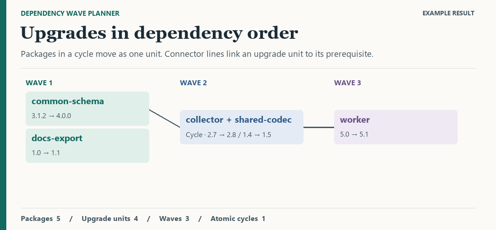
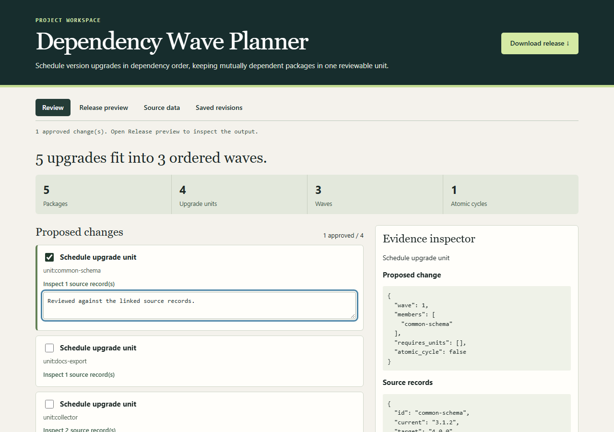

# Dependency Wave Planner

Schedule version upgrades in dependency order, keeping mutually dependent packages in one reviewable unit.

[](https://github.com/oguzhanozfe/dependency-wave-planner/actions/workflows/check.yml) · [Deploy to Render](https://render.com/deploy?repo=https://github.com/oguzhanozfe/dependency-wave-planner) · [Input guide](GUIDE.md)

Several packages need to move together. See which upgrades can go first and which dependencies create a cycle before scheduling the release.



## Try it

With Python 3.11+ installed, clone this repository and run:

```sh
git clone https://github.com/oguzhanozfe/dependency-wave-planner.git
cd dependency-wave-planner
python app.py
```

Open <http://127.0.0.1:8000>. The synthetic example is loaded. Select a proposed change, inspect its source records, and open **Release preview** to see the resulting files. Choose **Download release** to save them.

## Walk through the example

Describe the upgrade jobs you intend to ship. Each package has a stable ID, current version, target version and an optional depends_on list of other upgrade jobs in the inventory. Omit external dependencies that are outside the rollout. Versions are opaque identifiers, so the planner also works with internal release numbers.

**What the engine finds.** 5 upgrades fit into 3 ordered waves.

**Try this decision.** Approve **Schedule upgrade unit**. The [example review](docs/example-review.json) lists the supporting record IDs and the checksum of each exported file. Its native outputs are [`rollout-waves.json`](docs/example-release/rollout-waves.json), [`rollback-order.json`](docs/example-release/rollback-order.json).

Reproduce that release at the command line:

```sh
python app.py analyze example.json
python app.py export example.json --approve "unit:common-schema" --out reviewed.zip
```

## Model-assisted review

With a local model in Ollama or LM Studio, Azure OpenAI, Amazon Bedrock, or a compatible API connected, select **Request suggestions**. The model examines up to eight candidate actions. Each displayed suggestion links to one of that action's source records. Approving a change and recording a review note remain explicit reviewer actions.

The app runs locally with Python's standard library. The Docker image includes the Bedrock SDK and the production web server. The same UI can save immutable revisions, reopen a workspace and compare decisions. See [model settings, Docker deployment and the HTTP API](docs/deployment.md).



## Development

The domain algorithm and exporter live in [pipeline.py](pipeline.py). The [method guide](GUIDE.md) describes its input assumptions and limitations. Install test dependencies and run the suite:

```sh
python -m pip install -r requirements.txt
python -m unittest discover -v
```

[MIT license](LICENSE)
